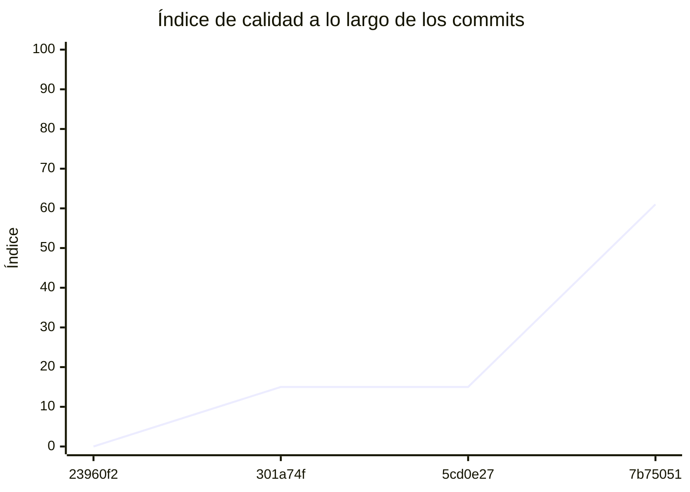

<!-- evaluacion:inicio -->
# Evaluación — Programacion2-IgnacioMilutin-2026/catalogo_service

> Documento **generado automáticamente** por la cátedra de Programación II (UM): RepoSense + análisis de calidad de **7 dimensiones**. **No editar a mano**: se regenera en cada evaluación.
> Rama evaluada: `main`. Análisis **heurístico** (regex + métricas) + build: es una criba para orientar la revisión, **no una nota**. La **documentación** del repositorio no se evalúa.
> Generado: 2026-11-20.

## 1. Veredicto

| Aspecto | Resultado |
|---|---|
| Índice de calidad | **72/100** |
| Tipo de repositorio | `backend` |
| Build (`mvnw verify` / `gradlew check`) | OK |
| Código (LOC) | 8,698 |
| Archivos de código | 174 |
| Clases | 219 |
| Código dentro de clases (%POO) | 74% |
| Funciones fuera de clases | 0 |
| Duplicación (puerta) | 3.0% |
| Duplicación lógica | 3.2% |
| Duplicación de boilerplate | 20.4% |
| Cobertura | 97% |
| Tope duro aplicado a D1 | `POO_BAJO` → D1 ≤ 60 |

> Este informe **describe** lo que el análisis midió con los criterios ya establecidos de la materia. No es una nota.

## 2. Semáforo de aprobación

Criterios de la cátedra (`CRITERIOS-CALIDAD.md`): **Aprobar** se juega con el perfil `estandar`; **destacar**, con el `exigente` (meta de excelencia).

| Semáforo | Resultado |
|---|---|
| Aprobar (`estandar`) | **no cumple** — 7/11 |
| Destacar (`exigente`) | **no cumple** — 5/11 |

**Para aprobar, falta cumplir:** Duplicación

**Para destacar, falta cumplir:** SOLID; POO; Duplicación

## 3. Autoría (RepoSense)

| Autor | Commits | Código (LOC) | Tests (LOC) | Docs (LOC) | Días activos | % del código |
|---|---:|---:|---:|---:|---:|---:|
| Ignacio Milutin | 46 | 3,784 | 6,720 | 3,621 | 7 | 100% |

> _El LOC de autoría lo calcula RepoSense sobre el historial y puede diferir del LOC de código del análisis (que mira el estado de `main`)._

## 4. Dimensiones evaluadas

Cada dimensión indica **qué mide**, **por qué importa** y **tu resultado**. Cuando el puntaje queda por debajo de la referencia, se agregan preguntas para **investigar la causa** (no hay recetas).

| Dimensión | Peso | Puntaje |
|:--|--:|--:|
| **D1** Diseño OO, SOLID y patrones (20%) | 20% | 5 |
| **D2** Arquitectura hexagonal — backend (15%) | 15% | 100 |
| **D3** Frontend KMP: MVVM y buenas prácticas (10%) | 10% | N/A |
| **D4** Integración y contrato (10%) | 10% | 40 |
| **D5** Seguridad y robustez (10%) | 10% | 100 |
| **D6** Pruebas y cobertura (20%) | 20% | 100 |
| **D7** Proceso y entrega (15%) | 15% | 100 |

### D1. Diseño OO, SOLID y patrones (20%)

- **Qué mide:** Métricas orientadas a objetos (clases, métodos, campos, cohesión, acoplamiento, herencia) y proxies de SOLID, más patrones de diseño.
- **Por qué importa:** El eje de la materia es el buen uso de la POO y su arquitectura: un diseño con clases claras y poco acopladas es más fácil de entender, probar y cambiar.
- **Tu resultado:** **5/100**
- **Para investigar la causa:**
    - ¿Se pensó el modelo de clases antes de codificar o se agrupó después?
    - ¿Qué clases concentran muchas responsabilidades a la vez?
    - ¿Los colaboradores llegan como parámetros o se crean por dentro?

### D2. Arquitectura hexagonal — backend (15%)

- **Qué mide:** Separación en capas (dominio, puertos de entrada/salida, adaptadores) y dirección de las dependencias del backend.
- **Por qué importa:** Aislar el dominio de la infraestructura permite cambiar la base de datos, el framework o el transporte sin tocar las reglas de negocio.
- **Tu resultado:** **100/100**

### D4. Integración y contrato (10%)

- **Qué mide:** Cumplimiento del contrato de integración de la cátedra (formato de errores, paginación, autenticación, endpoints esperados).
- **Por qué importa:** Los servicios deben poder integrarse entre sí y con la app sin sorpresas; el contrato es lo que hacen cumplir las pruebas de integración.
- **Tu resultado:** **40/100**
- **Para investigar la causa:**
    - ¿Qué endpoints difieren del contrato acordado?
    - ¿Los errores se devuelven con un formato uniforme?
    - ¿La autenticación es consistente entre servicios?

### D5. Seguridad y robustez (10%)

- **Qué mide:** Credenciales embebidas, consultas SQL por concatenación, y presencia de config de entorno; aislamiento de secretos.
- **Por qué importa:** Un secreto en el repositorio o una consulta construida por concatenación son riesgos concretos, no hipotéticos.
- **Tu resultado:** **100/100**

### D6. Pruebas y cobertura (20%)

- **Qué mide:** Cantidad y resultado de pruebas y cobertura de línea (JaCoCo/Kover, Surefire/Failsafe) cuando hay build.
- **Por qué importa:** Las pruebas son la red de seguridad para refactorizar e integrar; la cobertura acota las zonas sin verificar.
- **Tu resultado:** **100/100**

### D7. Proceso y entrega (15%)

- **Qué mide:** Artefactos verificables de proceso/entrega: `compose`, `.env.example`, CI (`.github/workflows/`), `CODEOWNERS` y wrapper de build (`mvnw`/`gradlew`). **No** puntúa documentación.
- **Por qué importa:** Un proyecto que compila, se levanta y se valida solo es más fácil de revisar y de integrar en equipo.
- **Tu resultado:** **100/100**

## 5. Señales detectadas

El análisis encontró las siguientes señales, con el archivo y la línea donde se originan cuando están disponibles:

**Archivos con más señales**

| Archivo | Señales |
|---|---:|
| `src/main/java/catalogo/synchronization/application/usecases/VerifyCatalogVersionUseCaseImpl.java` | 11 |
| `src/main/java/catalogo/catedra/infrastructure/client/CatedraRedisClientAdapter.java` | 7 |
| `src/main/java/catalogo/catedra/infrastructure/client/mapper/CatalogVersionChangesMapper.java` | 7 |
| `src/main/java/catalogo/catalog/application/usecases/ApplyCatalogVersionUseCaseImpl.java` | 7 |
| `src/main/java/catalogo/catedra/infrastructure/client/CatedraLoginClientAdapter.java` | 6 |
| `src/main/java/catalogo/synchronization/application/usecases/SynchronizeFullCatalogUseCaseImpl.java` | 4 |
| `src/main/java/catalogo/catedra/infrastructure/client/CatedraSnapshotClientAdapter.java` | 4 |
| `src/main/java/catalogo/catedra/application/usecases/GetCatalogSnapshotUseCaseImpl.java` | 4 |
| `src/main/java/catalogo/catedra/application/usecases/StartTechnicalSessionUseCaseImpl.java` | 4 |
| `src/main/java/catalogo/catedra/infrastructure/client/mapper/CatedraEntityMapper.java` | 3 |

**SRP/responsabilidad** (54)
- clase 'ApplyCatalogVersionUseCaseImpl' con baja cohesión (0%) — `src/main/java/catalogo/catalog/application/usecases/ApplyCatalogVersionUseCaseImpl.java:31`
- método 'ApplyCatalogVersionUseCaseImpl.applyCatalogVersion' de 42 líneas — `src/main/java/catalogo/catalog/application/usecases/ApplyCatalogVersionUseCaseImpl.java:41`
- método 'ApplyCatalogVersionUseCaseImpl.applyCatalogVersion' con complejidad 6 — `src/main/java/catalogo/catalog/application/usecases/ApplyCatalogVersionUseCaseImpl.java:41`
- método 'ApplyCatalogVersionUseCaseImpl.withLocal' con 7 parámetros — `src/main/java/catalogo/catalog/application/usecases/ApplyCatalogVersionUseCaseImpl.java:89`
- método 'ApplyCatalogVersionUseCaseImpl.referencedIds' con 5 parámetros — `src/main/java/catalogo/catalog/application/usecases/ApplyCatalogVersionUseCaseImpl.java:99`
- método 'ApplyCatalogVersionUseCaseImpl.known' con 5 parámetros — `src/main/java/catalogo/catalog/application/usecases/ApplyCatalogVersionUseCaseImpl.java:107`
- método 'CatalogRedisReader.read' de 62 líneas — `src/main/java/catalogo/catedra/application/support/CatalogRedisReader.java:27`
- método 'CatalogRedisReader.read' con complejidad 13 — `src/main/java/catalogo/catedra/application/support/CatalogRedisReader.java:27`
- método 'AwaitInitialTechnicalSessionUseCaseImpl.awaitInitialTechnicalSession' con complejidad 6 — `src/main/java/catalogo/catedra/application/usecases/AwaitInitialTechnicalSessionUseCaseImpl.java:24`
- clase 'GetCatalogSnapshotUseCaseImpl' con baja cohesión (17%) — `src/main/java/catalogo/catedra/application/usecases/GetCatalogSnapshotUseCaseImpl.java:24`
- método 'GetCatalogSnapshotUseCaseImpl.getCatalogSnapshot' de 62 líneas — `src/main/java/catalogo/catedra/application/usecases/GetCatalogSnapshotUseCaseImpl.java:32`
- método 'GetCatalogSnapshotUseCaseImpl.getCatalogSnapshot' con complejidad 14 — `src/main/java/catalogo/catedra/application/usecases/GetCatalogSnapshotUseCaseImpl.java:32`
- clase 'RenewTechnicalSessionUseCaseImpl' con baja cohesión (10%) — `src/main/java/catalogo/catedra/application/usecases/RenewTechnicalSessionUseCaseImpl.java:22`
- método 'RenewTechnicalSessionUseCaseImpl.attemptLogin' con complejidad 8 — `src/main/java/catalogo/catedra/application/usecases/RenewTechnicalSessionUseCaseImpl.java:50`
- clase 'StartTechnicalSessionUseCaseImpl' con baja cohesión (33%) — `src/main/java/catalogo/catedra/application/usecases/StartTechnicalSessionUseCaseImpl.java:20`
- método 'StartTechnicalSessionUseCaseImpl.startTechnicalSession' de 31 líneas — `src/main/java/catalogo/catedra/application/usecases/StartTechnicalSessionUseCaseImpl.java:29`
- método 'StartTechnicalSessionUseCaseImpl.startTechnicalSession' con complejidad 10 — `src/main/java/catalogo/catedra/application/usecases/StartTechnicalSessionUseCaseImpl.java:29`
- método 'CatalogSnapshot.CatalogSnapshot' de 38 líneas — `src/main/java/catalogo/catedra/domain/model/CatalogSnapshot.java:10`
- método 'CatedraProfessional.CatedraProfessional' con 5 parámetros — `src/main/java/catalogo/catedra/domain/model/CatedraProfessional.java:4`
- método 'CatedraWeeklySchedule.CatedraWeeklySchedule' con 7 parámetros — `src/main/java/catalogo/catedra/domain/model/CatedraWeeklySchedule.java:7`
- método 'TechnicalIntegration.TechnicalIntegration' de 40 líneas — `src/main/java/catalogo/catedra/domain/model/TechnicalIntegration.java:7`
- método 'TechnicalIntegration.TechnicalIntegration' con 9 parámetros — `src/main/java/catalogo/catedra/domain/model/TechnicalIntegration.java:7`
- método 'TechnicalLoginPolicy.TechnicalLoginPolicy' con 5 parámetros — `src/main/java/catalogo/catedra/domain/model/TechnicalLoginPolicy.java:6`
- método 'TechnicalSession.TechnicalSession' de 32 líneas — `src/main/java/catalogo/catedra/domain/model/TechnicalSession.java:7`
- clase 'CatedraLoginClientAdapter' grande (LOC=107, métodos=8, campos=8) — `src/main/java/catalogo/catedra/infrastructure/client/CatedraLoginClientAdapter.java:28`
- clase 'CatedraLoginClientAdapter' con baja cohesión (4%) — `src/main/java/catalogo/catedra/infrastructure/client/CatedraLoginClientAdapter.java:28`
- método 'CatedraLoginClientAdapter.login' de 38 líneas — `src/main/java/catalogo/catedra/infrastructure/client/CatedraLoginClientAdapter.java:54`
- método 'CatedraLoginClientAdapter.login' con complejidad 10 — `src/main/java/catalogo/catedra/infrastructure/client/CatedraLoginClientAdapter.java:54`
- método 'CatedraLoginClientAdapter.configurationProblemOf' con complejidad 7 — `src/main/java/catalogo/catedra/infrastructure/client/CatedraLoginClientAdapter.java:102`
- método 'CatedraProperties.CatedraProperties' de 44 líneas — `src/main/java/catalogo/catedra/infrastructure/client/CatedraProperties.java:10`
- clase 'CatedraRedisClientAdapter' grande (LOC=146, métodos=11, campos=9) — `src/main/java/catalogo/catedra/infrastructure/client/CatedraRedisClientAdapter.java:36`
- clase 'CatedraRedisClientAdapter' con baja cohesión (7%) — `src/main/java/catalogo/catedra/infrastructure/client/CatedraRedisClientAdapter.java:36`
- método 'CatedraRedisClientAdapter.readVersionChanges' con complejidad 6 — `src/main/java/catalogo/catedra/infrastructure/client/CatedraRedisClientAdapter.java:61`
- método 'CatedraRedisClientAdapter.byId' con complejidad 6 — `src/main/java/catalogo/catedra/infrastructure/client/CatedraRedisClientAdapter.java:100`
- método 'CatedraRedisClientAdapter.classify' con complejidad 6 — `src/main/java/catalogo/catedra/infrastructure/client/CatedraRedisClientAdapter.java:153`
- clase 'CatedraSnapshotClientAdapter' con baja cohesión (17%) — `src/main/java/catalogo/catedra/infrastructure/client/CatedraSnapshotClientAdapter.java:23`
- método 'CatedraSnapshotClientAdapter.fetchSnapshot' de 33 líneas — `src/main/java/catalogo/catedra/infrastructure/client/CatedraSnapshotClientAdapter.java:42`
- método 'CatedraSnapshotClientAdapter.fetchSnapshot' con complejidad 9 — `src/main/java/catalogo/catedra/infrastructure/client/CatedraSnapshotClientAdapter.java:42`
- método 'CatalogSnapshotMapper.checkEach' con 6 parámetros — `src/main/java/catalogo/catedra/infrastructure/client/mapper/CatalogSnapshotMapper.java:42`
- clase 'CatalogVersionChangesMapper' con baja cohesión (5%) — `src/main/java/catalogo/catedra/infrastructure/client/mapper/CatalogVersionChangesMapper.java:31`
- método 'CatalogVersionChangesMapper.changesOf' de 33 líneas — `src/main/java/catalogo/catedra/infrastructure/client/mapper/CatalogVersionChangesMapper.java:55`
- método 'CatalogVersionChangesMapper.changesOf' con complejidad 8 — `src/main/java/catalogo/catedra/infrastructure/client/mapper/CatalogVersionChangesMapper.java:55`
- método 'CatalogVersionChangesMapper.versionChangesOf' con 8 parámetros — `src/main/java/catalogo/catedra/infrastructure/client/mapper/CatalogVersionChangesMapper.java:94`
- método 'CatalogVersionChangesMapper.entities' con 13 parámetros — `src/main/java/catalogo/catedra/infrastructure/client/mapper/CatalogVersionChangesMapper.java:118`
- método 'CatalogVersionChangesMapper.entities' con complejidad 6 — `src/main/java/catalogo/catedra/infrastructure/client/mapper/CatalogVersionChangesMapper.java:118`
- clase 'CatedraEntityMapper' grande (LOC=80, métodos=11, campos=1) — `src/main/java/catalogo/catedra/infrastructure/client/mapper/CatedraEntityMapper.java:20`
- clase 'SynchronizeFullCatalogUseCaseImpl' con baja cohesión (0%) — `src/main/java/catalogo/synchronization/application/usecases/SynchronizeFullCatalogUseCaseImpl.java:28`
- método 'SynchronizeFullCatalogUseCaseImpl.synchronizeFullCatalog' con complejidad 6 — `src/main/java/catalogo/synchronization/application/usecases/SynchronizeFullCatalogUseCaseImpl.java:36`
- método 'SynchronizeFullCatalogUseCaseImpl.localCopyOf' de 33 líneas — `src/main/java/catalogo/synchronization/application/usecases/SynchronizeFullCatalogUseCaseImpl.java:81`
- clase 'VerifyCatalogVersionUseCaseImpl' grande (LOC=190, métodos=12, campos=10) — `src/main/java/catalogo/synchronization/application/usecases/VerifyCatalogVersionUseCaseImpl.java:36`
- clase 'VerifyCatalogVersionUseCaseImpl' con baja cohesión (2%) — `src/main/java/catalogo/synchronization/application/usecases/VerifyCatalogVersionUseCaseImpl.java:36`
- método 'VerifyCatalogVersionUseCaseImpl.applyPendingVersions' con complejidad 7 — `src/main/java/catalogo/synchronization/application/usecases/VerifyCatalogVersionUseCaseImpl.java:92`
- método 'VerifyCatalogVersionUseCaseImpl.apply' de 32 líneas — `src/main/java/catalogo/synchronization/application/usecases/VerifyCatalogVersionUseCaseImpl.java:111`
- método 'VerifyCatalogVersionUseCaseImpl.apply' con complejidad 6 — `src/main/java/catalogo/synchronization/application/usecases/VerifyCatalogVersionUseCaseImpl.java:111`

**DIP/concretos** (22)
- clase 'ApplyCatalogVersionUseCaseImpl' muy acoplada (CBO=17) — `src/main/java/catalogo/catalog/application/usecases/ApplyCatalogVersionUseCaseImpl.java:31`
- clase 'ReplaceCatalogUseCaseImpl' muy acoplada (CBO=13) — `src/main/java/catalogo/catalog/application/usecases/ReplaceCatalogUseCaseImpl.java:24`
- clase 'JpaCatalogSyncStateRepositoryAdapter' muy acoplada (CBO=8) — `src/main/java/catalogo/catalog/infrastructure/persistence/adapter/JpaCatalogSyncStateRepositoryAdapter.java:14`
- clase 'CatalogRedisReader' muy acoplada (CBO=19) — `src/main/java/catalogo/catedra/application/support/CatalogRedisReader.java:21`
- clase 'AwaitInitialTechnicalSessionUseCaseImpl' muy acoplada (CBO=9) — `src/main/java/catalogo/catedra/application/usecases/AwaitInitialTechnicalSessionUseCaseImpl.java:18`
- clase 'GetCatalogMetadataUseCaseImpl' muy acoplada (CBO=12) — `src/main/java/catalogo/catedra/application/usecases/GetCatalogMetadataUseCaseImpl.java:15`
- clase 'GetCatalogSnapshotUseCaseImpl' muy acoplada (CBO=25) — `src/main/java/catalogo/catedra/application/usecases/GetCatalogSnapshotUseCaseImpl.java:24`
- clase 'GetCatalogVersionChangesUseCaseImpl' muy acoplada (CBO=12) — `src/main/java/catalogo/catedra/application/usecases/GetCatalogVersionChangesUseCaseImpl.java:15`
- clase 'RenewTechnicalSessionUseCaseImpl' muy acoplada (CBO=15) — `src/main/java/catalogo/catedra/application/usecases/RenewTechnicalSessionUseCaseImpl.java:22`
- clase 'StartTechnicalSessionUseCaseImpl' muy acoplada (CBO=16) — `src/main/java/catalogo/catedra/application/usecases/StartTechnicalSessionUseCaseImpl.java:20`
- clase 'TechnicalSession' muy acoplada (CBO=8) — `src/main/java/catalogo/catedra/domain/model/TechnicalSession.java:7`
- clase 'TechnicalSession' instancia 4 concretos (CBO=8) — `src/main/java/catalogo/catedra/domain/model/TechnicalSession.java:7`
- clase 'CatedraClientConfiguration' muy acoplada (CBO=9) — `src/main/java/catalogo/catedra/infrastructure/client/CatedraClientConfiguration.java:12`
- clase 'CatedraClientConfiguration' instancia 4 concretos (CBO=9) — `src/main/java/catalogo/catedra/infrastructure/client/CatedraClientConfiguration.java:12`
- clase 'CatedraLoginClientAdapter' muy acoplada (CBO=27) — `src/main/java/catalogo/catedra/infrastructure/client/CatedraLoginClientAdapter.java:28`
- clase 'CatedraRedisClientAdapter' muy acoplada (CBO=39) — `src/main/java/catalogo/catedra/infrastructure/client/CatedraRedisClientAdapter.java:36`
- clase 'CatedraSnapshotClientAdapter' muy acoplada (CBO=27) — `src/main/java/catalogo/catedra/infrastructure/client/CatedraSnapshotClientAdapter.java:23`
- clase 'CatalogVersionChangesMapper' muy acoplada (CBO=21) — `src/main/java/catalogo/catedra/infrastructure/client/mapper/CatalogVersionChangesMapper.java:31`
- clase 'CatedraEntityMapper' muy acoplada (CBO=10) — `src/main/java/catalogo/catedra/infrastructure/client/mapper/CatedraEntityMapper.java:20`
- clase 'CatedraEntityMapper' instancia 3 concretos (CBO=10) — `src/main/java/catalogo/catedra/infrastructure/client/mapper/CatedraEntityMapper.java:20`
- clase 'SynchronizeFullCatalogUseCaseImpl' muy acoplada (CBO=28) — `src/main/java/catalogo/synchronization/application/usecases/SynchronizeFullCatalogUseCaseImpl.java:28`
- clase 'VerifyCatalogVersionUseCaseImpl' muy acoplada (CBO=46) — `src/main/java/catalogo/synchronization/application/usecases/VerifyCatalogVersionUseCaseImpl.java:36`

**OCP/type-switch** (2)
- clase 'CatedraRedisClientAdapter' con 3 type-checks — `src/main/java/catalogo/catedra/infrastructure/client/CatedraRedisClientAdapter.java:36`
- clase 'VerifyCatalogVersionUseCaseImpl' con 1 type-checks — `src/main/java/catalogo/synchronization/application/usecases/VerifyCatalogVersionUseCaseImpl.java:36`

**ISP/interfaces** (1)
- interfaz 'SnapshotFetchResult' con 5 métodos — `src/main/java/catalogo/catedra/domain/model/SnapshotFetchResult.java:4`

**duplicación** (6)
- duplicación lógica: 3.0% · boilerplate: 20.3%
- bloque de 8 líneas repetido 5 veces en src/main/java/catalogo/synchronization/application/usecases/VerifyCatalogVersionUseCaseImpl.java:190, src/main/java/catalogo/catedra/application/support/CatalogRedisReader.java:92, src/main/java/catalogo/catedra/application/usecases/GetCatalogSnapshotUseCaseImpl.java:109 — `src/main/java/catalogo/synchronization/application/usecases/VerifyCatalogVersionUseCaseImpl.java:190`
- bloque de 8 líneas repetido 5 veces en src/main/java/catalogo/synchronization/application/usecases/VerifyCatalogVersionUseCaseImpl.java:191, src/main/java/catalogo/catedra/application/support/CatalogRedisReader.java:93, src/main/java/catalogo/catedra/application/usecases/GetCatalogSnapshotUseCaseImpl.java:110 — `src/main/java/catalogo/synchronization/application/usecases/VerifyCatalogVersionUseCaseImpl.java:191`
- bloque de 8 líneas repetido 5 veces en src/main/java/catalogo/synchronization/application/usecases/VerifyCatalogVersionUseCaseImpl.java:192, src/main/java/catalogo/catedra/application/support/CatalogRedisReader.java:94, src/main/java/catalogo/catedra/application/usecases/GetCatalogSnapshotUseCaseImpl.java:111 — `src/main/java/catalogo/synchronization/application/usecases/VerifyCatalogVersionUseCaseImpl.java:192`
- bloque de 8 líneas repetido 5 veces en src/main/java/catalogo/synchronization/application/usecases/VerifyCatalogVersionUseCaseImpl.java:193, src/main/java/catalogo/catedra/application/support/CatalogRedisReader.java:95, src/main/java/catalogo/catedra/application/usecases/GetCatalogSnapshotUseCaseImpl.java:112 — `src/main/java/catalogo/synchronization/application/usecases/VerifyCatalogVersionUseCaseImpl.java:193`
- bloque de 8 líneas repetido 4 veces en src/main/java/catalogo/synchronization/domain/model/VerificationPolicy.java:9, src/main/java/catalogo/catedra/domain/model/TechnicalLoginPolicy.java:14, src/main/java/catalogo/catedra/domain/model/CatalogRedisPolicy.java:8 — `src/main/java/catalogo/synchronization/domain/model/VerificationPolicy.java:9`

## 6. Evolución por commit

Métricas calculadas sobre el estado de `main` en **cada commit** (4 commits con trabajo), del primero al último. La calidad usa el perfil `exigente`; el aporte de código lo mide RepoSense. El índice puede **bajar** al crecer el proyecto: se acumulan señales.

| # | Fecha | Commit | Autor | LOC | Índice | %POO | Duplic. | Sueltas |
|---|---|---|---|---:|---:|---:|---:|---:|
| 1 | 2026-09-14 | `23960f2` | Ing. Daniel Quinteros | 0 | 0 | 0% | 0.0% | 0 |
| 2 | 2026-09-14 | `301a74f` | Ing. Daniel Quinteros | 0 | 15 | 0% | 0.0% | 0 |
| 3 | 2026-10-13 | `5cd0e27` | IgnacioMilutin | 0 | 15 | 0% | 0.0% | 0 |
| 4 | 2026-11-19 | `7b75051` | IgnacioMilutin | 8,698 | 61 | 74% | 3.0% | 0 |

---
_Informe generado por la cátedra. Las dimensiones y umbrales corresponden a `calidad.py` (perfil `exigente`); el semáforo, a `CRITERIOS-CALIDAD.md`. La documentación del repositorio no se evalúa. Ante dudas, revisá el archivo señalado._
<!-- evaluacion:fin -->
