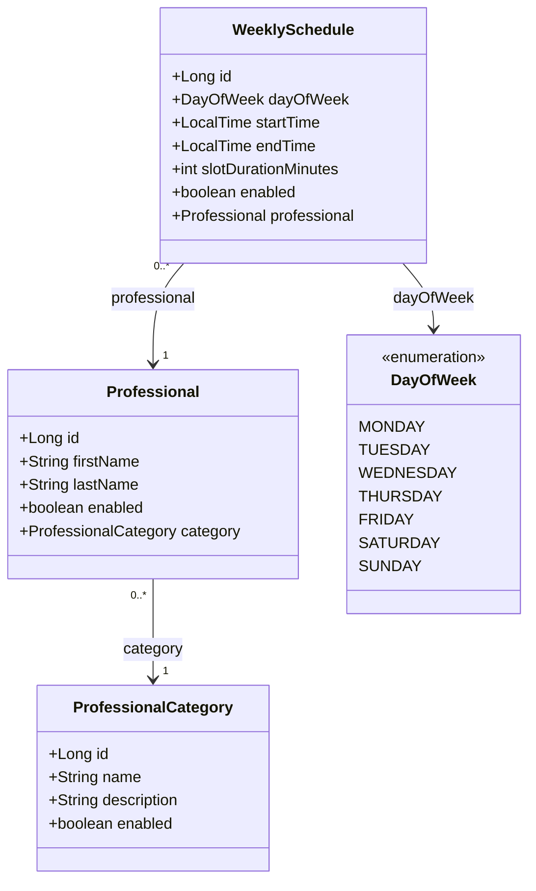
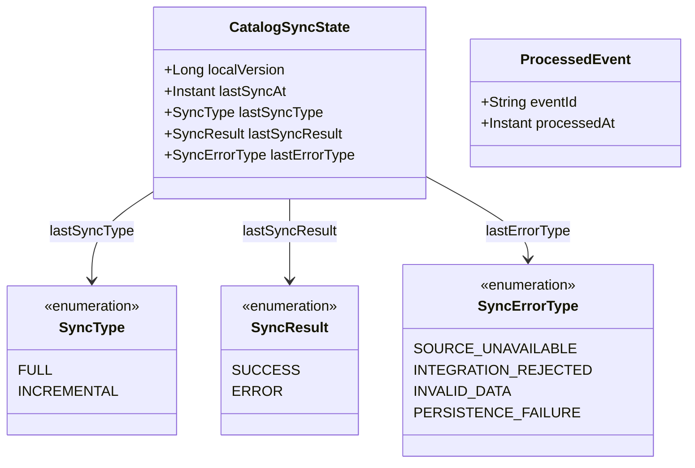

# Modelo de dominio — Servicio de Catálogo

## 1. Datos del catálogo

## 2. Sincronización

## 3. Atributos

| Clase | Atributo | Tipo | Regla |
| --- | --- | --- | --- |
| `ProfessionalCategory` | `id` | `Long` | Lo asigna la cátedra; nunca se genera localmente |
| `ProfessionalCategory` | `name` | `String` | Viene del snapshot y de Redis |
| `ProfessionalCategory` | `description` | `String` | Opcional |
| `ProfessionalCategory` | `enabled` | `boolean` | Baja lógica: se conserva y se devuelve con este campo |
| `Professional` | `id` | `Long` | Lo asigna la cátedra |
| `Professional` | `firstName` | `String` | Viene del snapshot y de Redis |
| `Professional` | `lastName` | `String` | Viene del snapshot y de Redis |
| `Professional` | `enabled` | `boolean` | Baja lógica |
| `Professional` | `category` | `ProfessionalCategory` | Obligatoria; en el contrato viaja como `categoryId` |
| `WeeklySchedule` | `id` | `Long` | Lo asigna la cátedra |
| `WeeklySchedule` | `professional` | `Professional` | Obligatorio; en el contrato viaja como `professionalId` |
| `WeeklySchedule` | `dayOfWeek` | `DayOfWeek` | `MONDAY` a `SUNDAY`. `DayOfWeek` es `java.time.DayOfWeek`, no una clase propia. |
| `WeeklySchedule` | `startTime` | `LocalTime` | Hora local de atención, sin zona horaria |
| `WeeklySchedule` | `endTime` | `LocalTime` | Hora local de atención, sin zona horaria |
| `WeeklySchedule` | `slotDurationMinutes` | `int` | Duración de cada turno, en minutos |
| `WeeklySchedule` | `enabled` | `boolean` | Baja lógica |
| `CatalogSyncState` | `localVersion` | `Long` | Vacío hasta que la primera sincronización completa termina bien; "catálogo inicializado" significa que tiene valor |
| `CatalogSyncState` | `lastSyncAt` | `Instant` | Momento, en UTC, del último intento de sincronización |
| `CatalogSyncState` | `lastSyncType` | `SyncType` | `FULL` para el snapshot (C01); `INCREMENTAL` para C02 y C03 |
| `CatalogSyncState` | `lastSyncResult` | `SyncResult` | `SUCCESS` o `ERROR` |
| `CatalogSyncState` | `lastErrorType` | `SyncErrorType` | Solo tiene valor si el resultado fue `ERROR` |
| `ProcessedEvent` | `eventId` | `String` | Identidad del registro y clave de idempotencia (anexo §15.1) |
| `ProcessedEvent` | `processedAt` | `Instant` | Momento, en UTC, en que se terminó de procesar |

### Valores de `SyncErrorType`

| Valor | De dónde sale |
| --- | --- |
| `SOURCE_UNAVAILABLE` | La cátedra o Redis no responden tras los reintentos |
| `INTEGRATION_REJECTED` | Credenciales o rol rechazados aun después de renovar la autenticación |
| `INVALID_DATA` | Snapshot incompleto o inconsistente, o estado no verificable que persiste |
| `PERSISTENCE_FAILURE` | Falla al guardar |

## 4. Reglas del modelo

| # | Regla |
| --- | --- |
| 1 | Los `id` los asigna la cátedra y nunca se generan localmente |
| 2 | Baja lógica: lo deshabilitado se conserva y se devuelve con `enabled`; nada se borra físicamente |
| 3 | Cada profesional referencia una categoría existente, y cada horario un profesional existente. Si no, no se aplica y se trata como estado no verificable |
| 4 | El `enabled` de categoría, profesional y horario son independientes entre sí |
| 5 | Solo los horarios habilitados cuentan para filtrar por disponibilidad semanal y generar turnos |
| 6 | Los turnos de un horario empiezan en `startTime`, se repiten cada `slotDurationMinutes` y solo cuentan los que terminan en o antes de `endTime` |
| 7 | `createdAt` y `updatedAt` no se guardan |
| 8 | Las horas de atención son `LocalTime` (sin zona horaria) y los instantes son `Instant` en UTC |
| 9 | Hay un único `CatalogSyncState`, y `localVersion` solo cambia en la misma unidad de trabajo que aplica los datos |
| 10 | `ProcessedEvent` se identifica por `eventId` y se crea al final de C02 |
