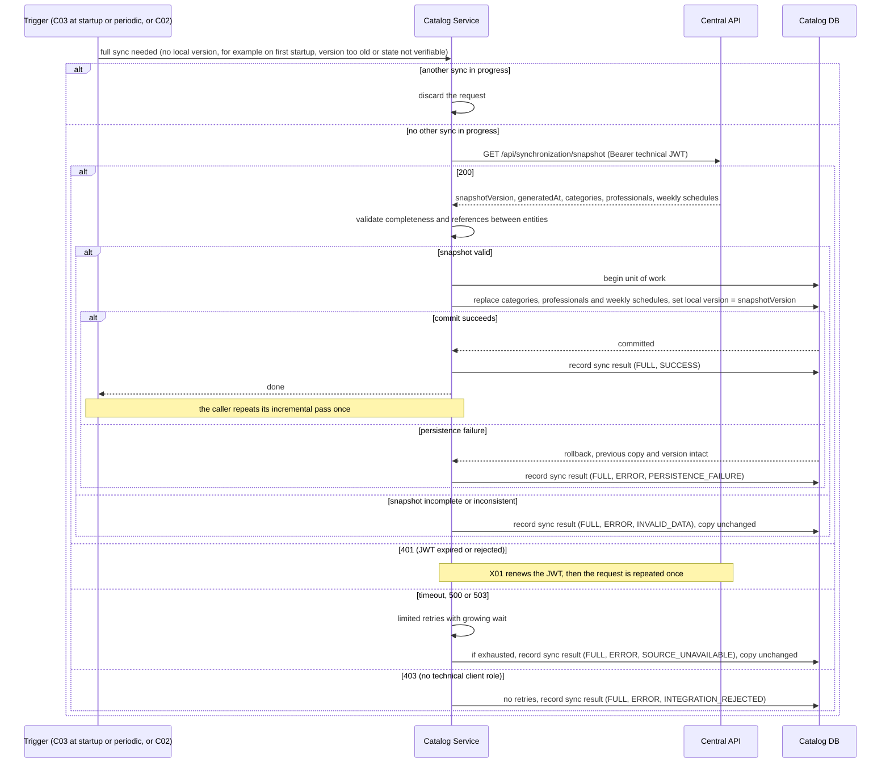
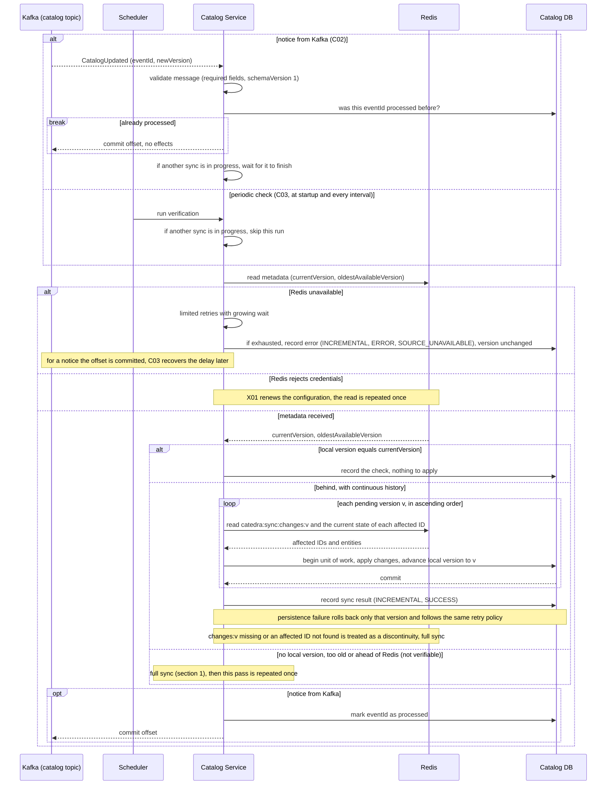
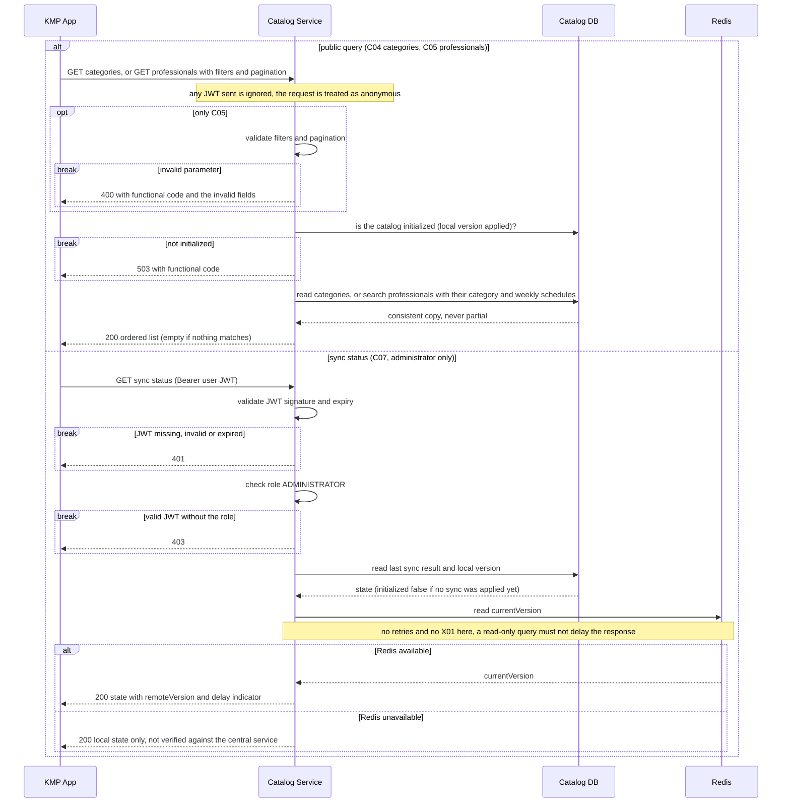

# Secuencias — catálogo y sincronización

## 1. Sincronización completa del catálogo (C01)

Caso de uso: C01. No arranca por sí sola: la dispara C03 (al arrancar el servicio y en cada verificación periódica) o C02 (ante un aviso de Kafka) cuando no hay versión local (por ejemplo, en el primer arranque con la base vacía), la versión local es menor que `oldestAvailableVersion`, o el estado no se puede verificar. En un arranque normal, con la copia al día, no se ejecuta. Cuando termina bien, quien la disparó repite una vez su pasada incremental (sección 2 de este archivo).

## 2. Sincronización incremental y verificación periódica (C02, C03)

Casos de uso: C02 y C03. Comparten el procedimiento de aplicar las versiones pendientes y solo cambia quién lo dispara. C02 reacciona a un aviso `CatalogUpdated` de Kafka. C03 corre al arrancar (después de X01) y a intervalos, y es la red de seguridad de C02 si un aviso se pierde. Si no se puede seguir de forma incremental, delegan en la sincronización completa (sección 1).

## 3. Consultas del catálogo desde la app (C04, C05, C07)

Casos de uso: C04, C05 y C07. C06 (horarios de un profesional) no se dibuja acá porque lo llama el servicio de turnos, y aparece en las secuencias de T03 y T04. C04 y C05 son públicos y C07 es solo para el rol ADMINISTRADOR. Ninguno llama a la API de la cátedra.

